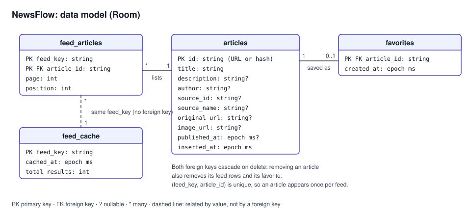
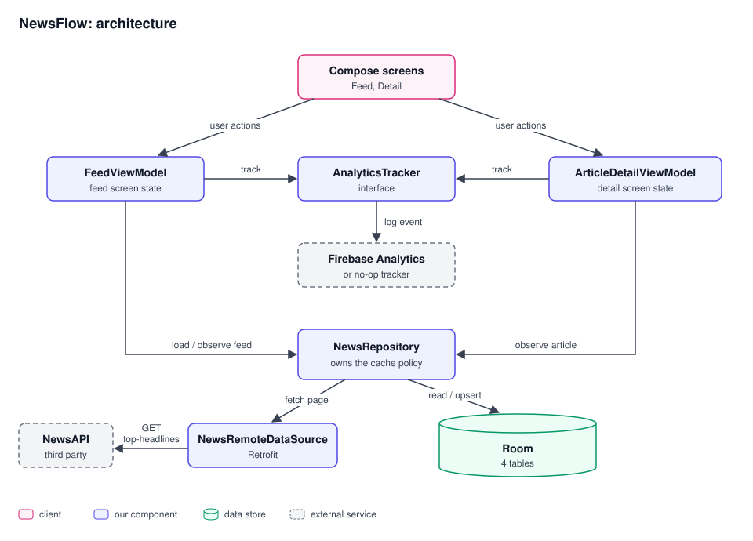
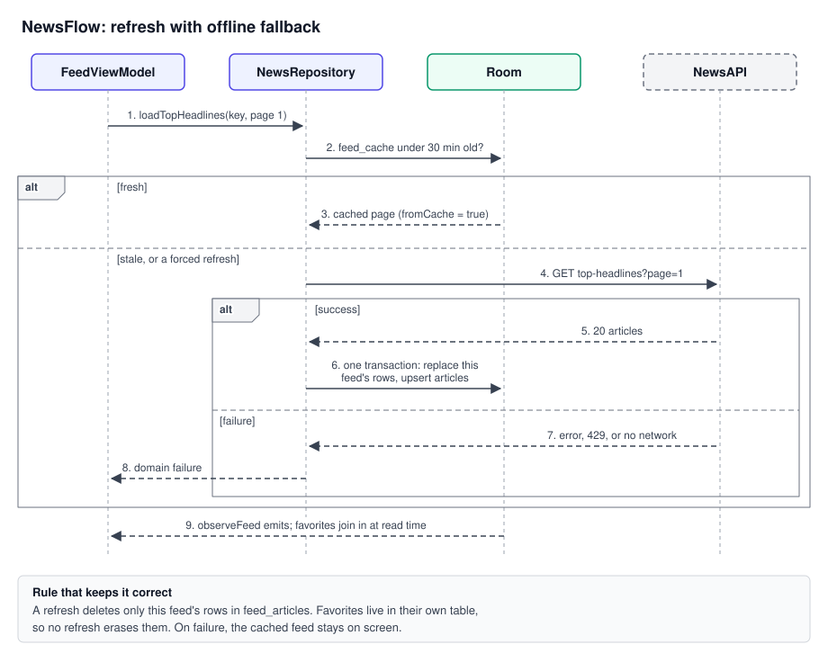

# NewsFlow: design

> Mode: Design · Size: System · Confirmed by client: unattended
> Written for the shipped Android app at github.com/huongstienstra/newsflow-system-design. Assumptions are labeled **Assumption**.

## Summary
An Android news reader: top US headlines, search, article detail, local favorites, and offline reading from cache, with privacy-safe analytics. The hard part is staying useful under a tiny shared API quota, and keeping the offline cache correct while refreshes replace it.

## 1. Requirements
**Functional**
- Browse top US headlines with pull-to-refresh and load-more.
- Search headlines by keyword, debounced.
- Open article detail, then the original article in the browser.
- Favorite and unfavorite articles.
- Read cached articles with no network.
- Track key user actions.

**Non-functional**
- Offline: cached feeds readable after a restart.
- Errors: every failure maps to a clear message; never a raw HTTP error.
- Privacy: no search text, full URLs, or raw article IDs in analytics.
- Security: no API keys or Firebase config committed.
- Quality: at least 80% line coverage, enforced in the build.

**Out of scope**
- Accounts, and syncing favorites across devices.
- Ranking or owning content beyond what NewsAPI returns.
- Push notifications.

## 2. Scale estimate
| Quantity | Math | Result |
|---|---|---|
| Users | **Assumption**: small public launch | 1,000 DAU |
| Requests per session | page 1 + 1 load-more + 1 search × 2 pages | 4 |
| Requests per user per day | 4 × 3 sessions (each past the 30-minute cache) | 12 |
| Requests per day | 1,000 × 12 | 12,000 |
| Peak rate | 12,000 ÷ 86,400 × 5 (morning peak) | 0.7 req/s |
| NewsAPI quota | **Assumption**: free developer plan, 100 requests/day per key | 100 |
| Users one key supports | 100 ÷ 12 | about 8 |
| Feed page payload | 20 articles × 1.5 KB JSON | 30 KB |
| Images per page | 20 × 80 KB thumbnails (**Assumption**) | 1.6 MB |
| Cache growth on device | 10 searches/day × 40 articles × 1.5 KB | 600 KB/day, 18 MB/month with no eviction |

The traffic itself is trivial (under 1 req/s). The hard part of this system is a shared third-party quota and key: every install calls NewsAPI with the same key, so about eight active users exhaust the day, and the key can be pulled out of the APK. The second hard part is the offline cache: refreshes replace it, but favorites and offline reads must survive.

## 3. Interfaces
**Remote**: `GET https://newsapi.org/v2/top-headlines?country=us&q=<query>&page=<n>&pageSize=20&apiKey=<key>`. A read; safe to retry.

**Repository contract** (the only boundary the ViewModels see)
- `observeFeed(feedKey): Flow<List<Article>>`: reads Room only.
- `observeArticle(articleId): Flow<Article?>`
- `loadTopHeadlines(feedKey, page, pageSize, forceRefresh): Result<FeedPage>`: retry-safe; a page write deletes and rewrites that page's rows in one transaction.
- `setFavorite(articleId, isFavorite): Result<Unit>`: retry-safe; an upsert or delete by article ID.

**FeedKey** names a cache entry: `top-headlines:country=us[:q=<query, trimmed, lowercased>]`. The default feed and each search are separate entries with their own pages.

**Data model (Room)**

- `articles`: one row per article (normalized), keyed by article ID.
- `feed_articles`: ordered membership of articles in a feed; (feed_key, article_id) is unique.
- `feed_cache`: freshness per feed.
- `favorites`: user state, never touched by refreshes.

**Cache rule**: page 1 is served from Room when it is under 30 minutes old and not a forced refresh. Later pages always hit the network.

## 4. High-level design

| State | Owner |
|---|---|
| Screen state (loading, error, query) | Each screen's ViewModel |
| Feed content and order | Room (`articles`, `feed_articles`), written only by the repository |
| Cache freshness | Room (`feed_cache`), written only by the repository |
| Favorites | Room (`favorites`), written only by `setFavorite` |
| Which article is open | The navigation argument (article ID only) |

Every component has a reason: the repository holds the offline policy so ViewModels stay about screen state; `AnalyticsTracker` makes Firebase optional and fakeable; Hilt wires the graph for tests.

## 5. Deep dives
### Offline cache that survives refreshes

The rule that keeps it correct: a refresh deletes only `feed_articles` rows for its own key. Favorites live in their own table and join in at read time, so no refresh can erase them, and an article shared by two feeds is stored once.

### The shared quota and key
- Today: the 30-minute page-1 cache and debounced search keep each user near 12 requests a day. That fits a portfolio app, where the client accepts the limit.
- Production: put a thin backend in front of NewsAPI. It holds the key and caches each FeedKey for 5 minutes. Upstream calls then scale with distinct queries, not users: about 12 per hour per popular feed. The app talks only to our backend. That removes the key from the APK and lets us rate-limit per install.

## 6. Failure modes
| Component or dependency | Slow | Down | Wrong data | What the user sees |
|---|---|---|---|---|
| NewsAPI | Request waits on the client timeout | `Network` or `Api` failure | Missing fields; the mapper drops articles with no title and falls back to a hashed ID when the URL is missing | Cached feed plus a warning; with no cache, an error state with retry |
| NewsAPI quota | – | 429 → `RateLimited` | – | "Too many requests, try later" over the cached feed |
| API key | – | Missing → `MissingApiKey`; revoked → `InvalidApiKey` | – | A clear setup or service error, never a crash |
| Device network | Load-more spinner | Request fails | – | Cached feed; load-more shows its own error with retry |
| Room | Slow first query on a big cache | Disk full, write fails | – | Refresh error; the last good cache stays readable |
| Image loading (Coil) | Placeholder stays | Placeholder | Wrong image is not possible; keyed by URL | Text-only card |
| Firebase | Events queue on device | Events dropped | – | Nothing; analytics never blocks the UI |
| Process death | – | – | – | Detail reopens from the article ID; feed reloads from Room |

**Security and privacy**
- The API key ships inside the APK and can be extracted. Mitigation: the backend proxy above; until then, the key lives in `local.properties` and the quota caps the damage.
- Analytics: search sends `query_length`, links send host and URL length, article IDs are hashed.
- Config: `local.properties` and `google-services.json` are git-ignored; without them the app builds with a no-op tracker.

## 7. Trade-offs
| Choice | Options | Decision | Reason | Cost |
|---|---|---|---|---|
| Where cache policy lives | ViewModel; repository; Store library | Repository | One place for product rules; ViewModels stay simple | The repository is the most complex class, with the most tests |
| Cache shape | One JSON blob per feed; normalized tables | Normalized, four tables | One copy per article; favorites independent of feeds | Join queries, and harder migrations |
| Pagination | Paging 3; hand-written | Hand-written | Small scope; full control over cache plus pages | We own edge cases Paging 3 already handles (refresh mid-scroll, page drift) |
| Freshness | Always network; TTL | 30-minute TTL on page 1 | Saves quota; instant cold start | Headlines can be 30 minutes old |
| Build vs buy: analytics | Firebase; self-hosted; none | Firebase behind an interface | Free, DebugView, swappable | Google dependency; privacy rules enforced by us |
| Build vs buy: news source | NewsAPI direct; our backend proxy; another provider | NewsAPI direct | No backend to run for a portfolio app | Shared quota and an extractable key (see Step 5) |

## 8. Verification
| Hard part or risk | Proved by |
|---|---|
| Favorites survive a refresh | `NewsRepositoryImplTest`: "favorite survives refresh that removes article from current feed" |
| 30-minute cache rule | `NewsRepositoryImplTest`: "fresh first page load uses cache", "force refresh bypasses fresh cache" |
| Offline fallback | `FeedViewModelTest`: "manual refresh failure keeps articles and clears refreshing", "initial load failure stops loading and shows error". Drill: airplane mode at launch, with and without a cache |
| Failure mapping | `FeedFailureMapperTest`: every HTTP and API code maps to one domain failure |
| Analytics privacy | `AnalyticsEventTest`, plus `FeedViewModelTest`: "search waits for debounce and logs privacy safe analytics" |
| Quota | Metric: 429 count and cache hit rate per day; alert when 429s pass 10% of requests |
| Coverage | Kover gate at 80% lines; last run 87% with 60 tests |

## Open risks
- The key in the APK, and the free plan's daily limit (the free developer plan is also for development use only; **Assumption**: confirm the current terms before a public release).
- No eviction: `feed_cache`, `feed_articles`, and unreferenced `articles` rows grow with every new search. Add a rule: keep the 20 most recent feed keys, then delete articles that are neither in a feed nor favorited. The foreign keys cascade on delete, so deleting a favorited article would also delete the favorite.
- Upstream page drift: if new stories shift results between page 1 and page 2, an article can come back on both pages. (feed_key, article_id) is unique and the insert replaces, so it is never shown twice, but it jumps from page 1 down to page 2. Add a test that pins this behavior.

## What would change this design
- Accounts or cross-device favorites → a backend with a sync layer, and favorites owned by the server.
- More than a handful of real users → the backend proxy becomes required, not optional.
- Realtime breaking news → push notifications plus a background refresh with WorkManager.
